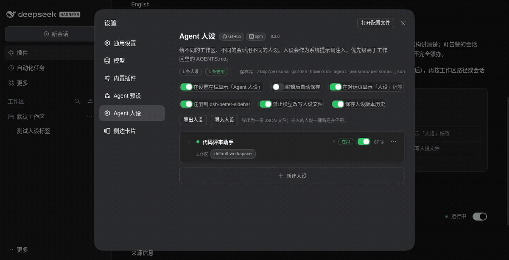
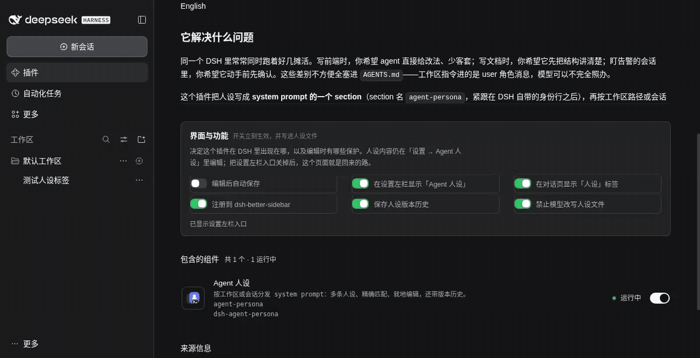
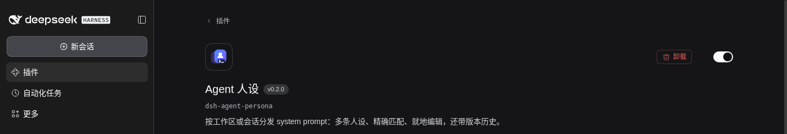
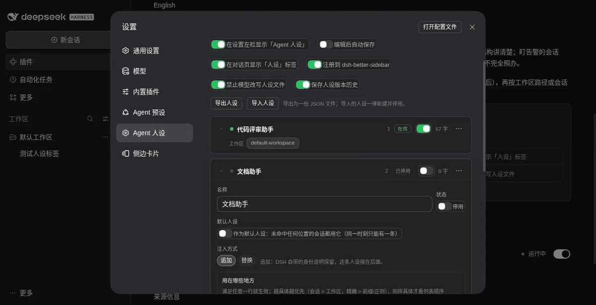
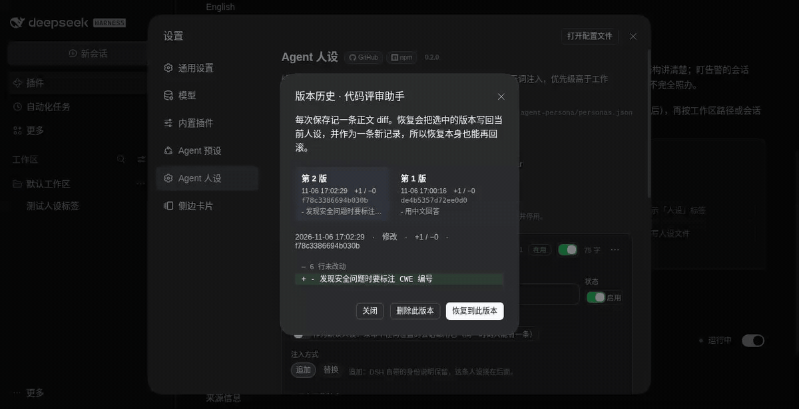
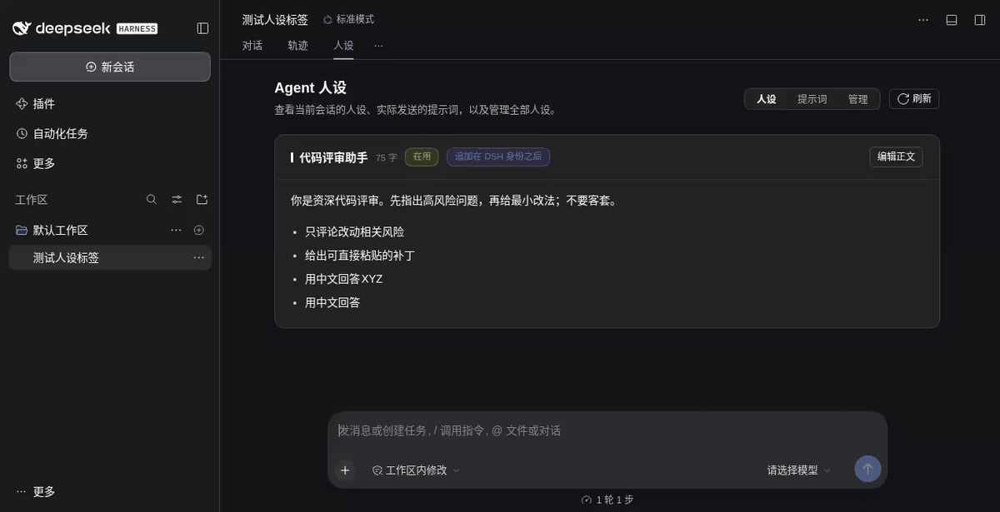
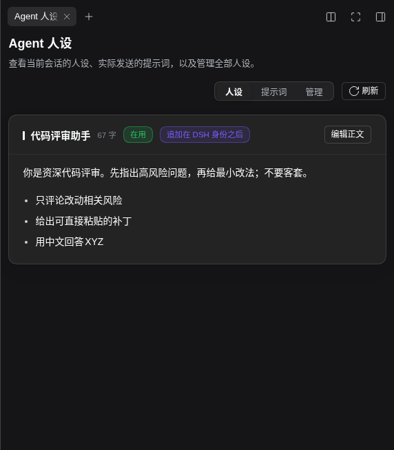

# dsh-agent-persona

给不同的**工作区**、不同的**会话**，用不同的 system prompt 人设。

[](https://www.npmjs.com/package/dsh-agent-persona)
[](./LICENSE)
[](https://github.com/Awoodwhale/dsh-agent-persona/actions/workflows/ci.yml)

[English](./README_EN.md)

## 它解决什么问题

同一个 DSH 里常常同时跑着好几摊活。写前端时，你希望 agent 直接给改法、少客套；写文档时，你希望它先把结构讲清楚；盯告警的会话里，你希望它动手前先确认。这些差别不方便全塞进 `AGENTS.md`——工作区指令进的是 user 角色消息，模型可以不完全照办。

这个插件把人设写成 **system prompt 的一个 section**（section 名 `agent-persona`，紧跟在 DSH 自带的身份行之后），再按工作区路径或会话 id 分发。一个位置只属于一条人设，越具体的规则越优先；改完之后，下一条消息就按新人设走。

## 安装

要求 DSH `0.2.0-rc.2` 及以上；当前版本在 `0.2.2-rc.1` 上实测通过（完整兼容列表见下文）。先在插件市场（如 dshmarket）或命令行装进你要用的 profile：

```bash
dsh plugin --profile web add dsh-agent-persona
```

装完**重启一次 `dsh web`**。profile 的 bundles 只在启动时读取，插件行就是从这里挂进去的。重启后设置左栏会多出 **Agent 人设**；`~/.dsh/dsh-agent-persona/state.json` 里也有加载心跳，写明了加载的文件、人设存哪、一共几条。

升级、卸载同样是 `dsh plugin --profile web update|remove dsh-agent-persona`，重启一次后生效。人设文件不会跟着删，也不会被覆盖。仓库里另有本地安装脚本：`bash scripts/install.sh`（Windows 用 `scripts/install.ps1`）。

## 三分钟上手



打开 **设置 → Agent 人设**，点 **新建人设**，然后在「适用范围」里一行一行加位置：先选 **工作区目录** 或 **某个会话**，再从下拉框里挑具体目标。下拉框的数据来自 DSH 自己的工作区与会话列表，显示标题和「几分钟前」，不用记 session id；想用前缀、包含或正则，选 **自己输入…**。

写完正文、打开启用开关、保存。有两点值得先知道：

- 新建出来的人设默认**停用**，所以多建一条不会影响任何现有会话；
- 一个位置只能归一条人设。把某个工作区配给新的人设时，原来占着它的那条会自动失去它，保存时会告诉你是从谁那里转来的。

## 界面入口

| 入口 | 位置 | 用来做什么 |
|---|---|---|
| **设置页** | 设置 → Agent 人设 | 新建、编辑、删除、复制、排序人设；写正文、Markdown 预览、让 AI 改一版。标题旁有 GitHub / npm 链接和当前安装版本 |
| **对话页「人设」** | 对话页顶部的 **人设** 标签 | 看这条会话命中了谁、实际发出去的 system prompt，也能就地管理全部人设 |
| **右侧栏卡片** | dsh-better-sidebar 的右侧栏 | 把同一个「人设」页面挂进右边栏（需要装该插件） |
| **插件详情页** | Web GUI → 插件 → dsh-agent-persona | 6 个偏好开关、插件图标与显示名 |

### 插件详情页里的配置



插件详情页多了「界面与功能」区块，副标题说明它决定插件在 DSH 里出现在哪、编辑时有哪些保护；人设内容仍在「设置 → Agent 人设」里编辑，关掉左栏入口后这个页面就是回来的路。6 个开关集中在这里，设置页里也保留了同一组，两处写的是同一份 `prefs`，改哪边都会同步；每次拨动立刻保存，没有「保存」按钮。

关掉「在设置左栏显示「Agent 人设」」只是从设置导航里隐藏，插件详情页仍在，可以继续改人设、随时开回来。插件列表里中文名是「Agent 人设」、英文名是「Agent Persona」，说明文字来自 `locale/`，图标是包根的 `icon.svg`，不跟随主题色。



## 人设列表与编辑

列表按优先级从上到下排列，卡片上能看到启用状态、默认人设标记、用在了哪些工作区与会话、正文长度和规则数。`⋯` 菜单里可以上移、下移、复制、删除。折叠状态下如果一条人设**一个位置都没加**，会写着「未设置位置：不生效，该会话仍用 DSH 自带的 prompt」——那是草稿，不是兜底。想让它兜底，打开卡片里的 **默认人设** 开关，同一时刻只允许一条。



展开卡片后可以改名称、默认人设、注入方式和正文。正文支持 Markdown 预览，也能让 DSH 当前设置的模型改一版；AI 只产出建议稿，点「采用」或「追加」才进编辑框，再保存才落盘。导入导出也在这一页：导出是一份 JSON 文件（同时复制到剪贴板）；导入可以选文件或直接粘贴，边输入边预览每条人设的字数与规则数，再以「一律新建、一律停用」的方式写进去，不会顶掉默认人设。

## 版本历史（可选）



打开 **保存版本历史** 后，每次保存正文都会在 `personas.history.json` 里记一条 diff。编辑器底部的 **版本历史** 按钮打开对比窗口：

- **只记正文**：改名称、启用状态、适用范围不产生版本；
- **存的是 diff**：相同行只记行数，只有真正改动的行保留原文；
- **恢复与删除**：任意一条都能恢复；恢复本身也记一版，恢复错了还能回滚。删除一条后，后面的版本会按新的前一条重算 diff，链不会断；
- **同文去重**：正文的 sha256 前 16 位相同就不新增版本，撤销、恢复后再保存、导入同一份正文都会命中；
- 关掉开关只是停止记录，已有历史仍可查看和恢复。

## 对话页的「人设」标签



选中一条会话后，顶部有 **人设 / 提示词 / 管理** 三个面板：

- **人设**：命中了哪条人设、依据是哪几条规则、正文渲染结果，以及就地编辑器；
- **提示词**：这条会话**实际发出去的** system prompt，可切换渲染/源码、复制、刷新；
- **管理**：和设置页同一套卡片，就地新建、启用、编辑、排序、复制、删除。

旁边的只读会话记录弹窗只显示你真正敲进去的内容，插件注入的「看起来像用户消息」的内容会折叠成一行提示；长消息可单条展开，也能跳到最新。

## 右侧栏卡片



装了 **dsh-better-sidebar** 之后，同一个「人设」页面可以挂进右侧栏。没装该插件时，「注册到 dsh-better-sidebar」这个开关不会出现，其余功能不受影响。

## 6 个偏好开关

| 开关 | 默认 | 作用 | 在哪里改 | 生效时机 |
|---|---|---|---|---|
| 在设置左栏显示「Agent 人设」 | 开 | 设置左侧导航里是否出现这个页面；关掉后从「插件 → dsh-agent-persona」进来 | 设置页或插件详情页 | 立即 |
| 在对话页显示「人设」标签 | 开 | 是否注册对话页顶部的「人设」标签 | 设置页或插件详情页 | 立即（运行时注册/注销） |
| 注册到 dsh-better-sidebar | 开 | 是否把人设页注册进右侧栏；没装该插件时这一项不出现 | 设置页或插件详情页 | 立即 |
| 编辑后自动保存 | 关 | 停手约 1 秒自动保存编辑区 | 设置页或插件详情页 | 立即；切换适用范围行时不自动保存，避免存下半截选择 |
| 保存人设版本历史 | 关 | 每次保存正文记一条可重放的 diff | 设置页或插件详情页 | 立即；关掉后不再记新版本，旧历史仍可查看 |
| 禁止模型改写人设文件 | 开 | 拒绝会写到人设存储的工具调用（读取、grep 不受影响） | 设置页或插件详情页 | 对下一次工具调用生效 |

偏好存在人设文件的 `prefs` 字段里，不是浏览器，所以它和数据的可见范围一致；浏览器只留一份镜像，用来决定加载时要不要注册视图。

## 匹配与优先级

每次组装 system prompt 时：

1. 停用的人设跳过；
2. 任意一行命中就成为候选，按具体度比较：会话 id（3 分）> 工作区（1 分），精确 > 前缀/包含/正则；
3. 具体度相同，取列表里靠上的那条；
4. 一个位置都没加的人设不参与匹配（草稿态），除非标了默认人设；
5. 谁都没命中，有默认人设就用它，没有就不注入；
6. 赢家的正文为空，等于「这里明确不要人设」，不注入任何东西。

四种匹配里只有 `完全一致` 会把路径归一化（`/a/project/` 和 `/a/project` 算同一个）；`开头是`、`包含`、`正则匹配` 拿你写的字符串原样比较。值空着、正则写错、会话没有对应字段，都算不匹配，不会报错。细节见 [docs/architecture.md](./docs/architecture.md)。

### 注入方式：追加还是替换

| 方式 | 效果 |
|---|---|
| **追加**（默认） | 保留 DSH 自带的身份句，人设接在它后面 |
| **替换** | 去掉 DSH 自带的身份句和部署自己写的 persona 段，只用这条人设 |

「替换」只动部署自己写的那段。如果某个 Agent 预设在自己的作用域里写了 persona，插件不会覆盖它——别人的身份提示优先。

正文里可以用 `{{model}}` 和 `{{cwd}}`，渲染时替换成当前值；其它 `{{...}}` 会被去掉，不会让整个组装报错。

还有一种情况得说清楚：有些 Agent 预设的人设段会声明 `complete: true`，意思是「这一节就是完整提示词」。
DSH 组装到最后会把别的 section 全扔掉，插件写的那节也一样，所以这种预设下人设看起来配好了、实际没发出去。
现在插件会在组装结束后检查一遍：要是只剩预设那一段、人设没进去，就把它补进去——追加接在后面，替换则
整段换成这条人设。换句话说，遇到这种预设时上面「别人的身份提示优先」就不作数了，那段提示词是唯一的位子。

## 数据与安全

```
~/.dsh/dsh-agent-persona/
├── personas.json          # 人设 + 偏好，权限 600，原子写入
├── personas.history.json  # 版本历史（开关打开后才出现）
└── state.json             # 加载心跳，每次加载时重写
```

默认是**全局一份**，同一台机器上的多个 profile 共用。要让某个 profile 独立，在它的 `cordis.patch.yml` 里覆盖 `storePath`：

```yaml
- id: agent-persona
  config:
    storePath: /Users/you/.dsh/profiles/<profile>/personas.json
```

当前生效的文件路径始终显示在「Agent 人设」页的 meta 行上（`保存在 …`）。配置项还有 `tuneProvider` / `tuneModel`，留空就用 DSH 当前设置的模型。

安全这块说清楚：**人设是行为约束，不是安全边界**。它约束模型怎么说，不阻止模型用工具。插件注册了一个全局 `tools.guard`，按能力判断这次调用会不会写到 `personas.json`、它的历史文件或备份副本——参数里的路径、shell 命令的重定向目标和写入型命令、补丁正文里的目标都算。但本机 `danger-full-access` 下仍能绕过：改插件代码、运行时拼接的路径、`$VAR` 展开、别名包装，静态判定都看不见。要更结实得在机器层面做，比如 `chflags uchg <人设文件>`，或者把 DSH 跑在受限沙箱里。

文件存在但读不出来时，页面会说明原因，并在第一次保存前把原文件备份成 `personas.json.bak-<时间戳>`；备份失败就不写入。

## 兼容性

当前 `package.json` 的 `dsh.compatibility` 声明为这些版本，`engines.dsh` 同样限定 `>=0.2.0-rc.2 <0.3.0`：

| DSH 版本 | 说明 |
|---|---|
| `0.2.0-rc.2` | 支持的最早版本 |
| `0.2.1-rc.2` | 实测通过 |
| `0.2.2-rc.1` | 本版实测通过（当前发布目标） |

这张表只表示「我们在这些版本上跑过」，不是对更早或更新版本的兼容承诺。

## 几句实话

- **只取第一条命中**，不拼接；规则是线性扫描，几十条没问题，几百条该重新设计。
- 一个 profile 里只装一次。同一个进程里挂两个同 id 的行，组合会起不来。
- 规则里的工作区路径按字符串比对，别依赖大小写或软链接的等价性（`完全一致` 会归一化路径，另外三种不会）。
- 仓库测试覆盖单元测试与源码审计，界面行为以浏览器实测为准。
- 人设文件里存的是明文，别把密钥写进正文。

## 开发

源码是 TypeScript，`lib/` 是构建产物（不进 git）：`src/index.ts` 是 host 半边（存储、匹配、system-prompt section、远程服务），`src/client.ts` 是 client 半边（设置页、对话页视图、侧边栏卡片），`src/endpoints.ts` 是远程方法的单一来源。目录结构见 [docs/architecture.md](./docs/architecture.md)。

```bash
npm install
npm run build        # generate:remote → tsc → esbuild（产出 lib/）
npm run typecheck    # 两个 tsconfig
npm test             # 单元测试 + 源码审计 + 生成产物漂移校验
```

改完代码怎么生效、开发接线怎么配，见 [docs/development.md](./docs/development.md)。

## 许可

Apache-2.0，见 [LICENSE](./LICENSE)。
