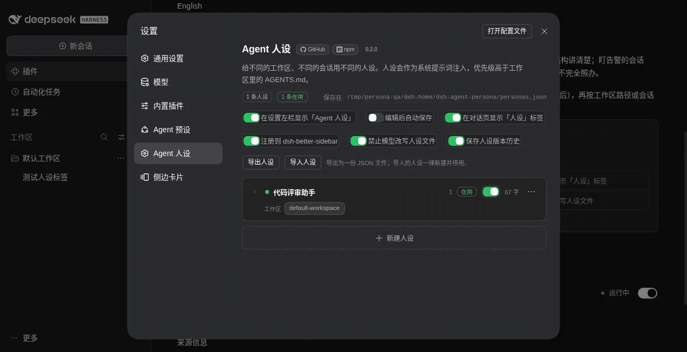
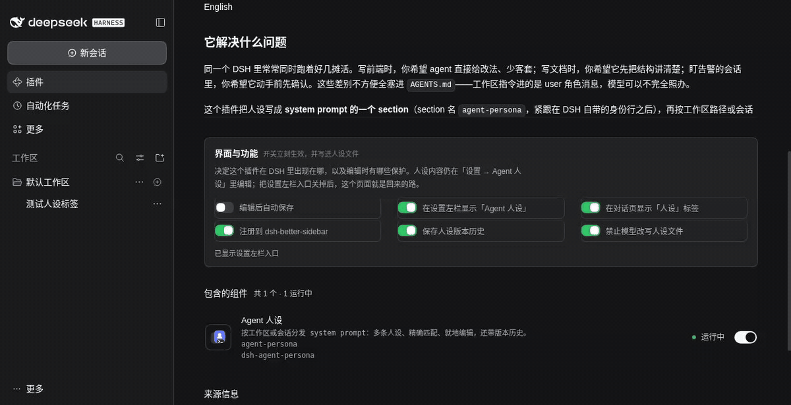
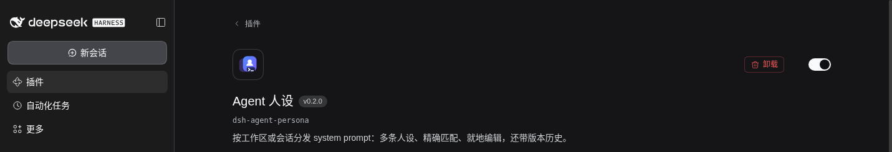
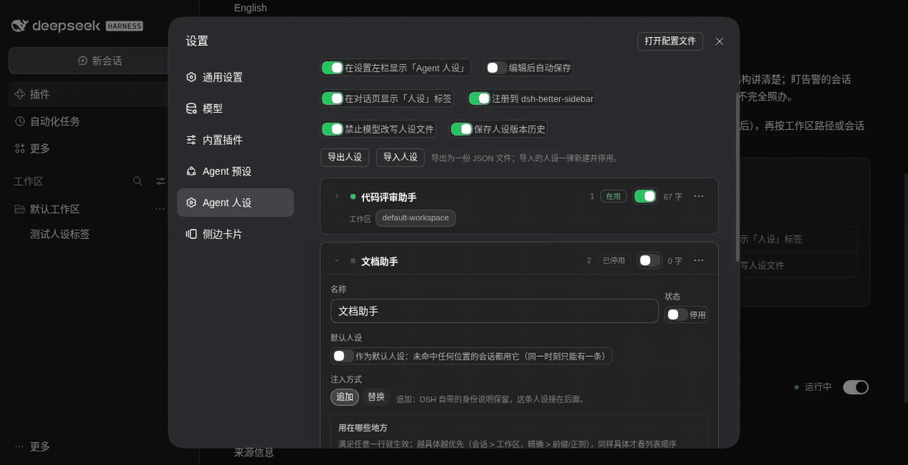
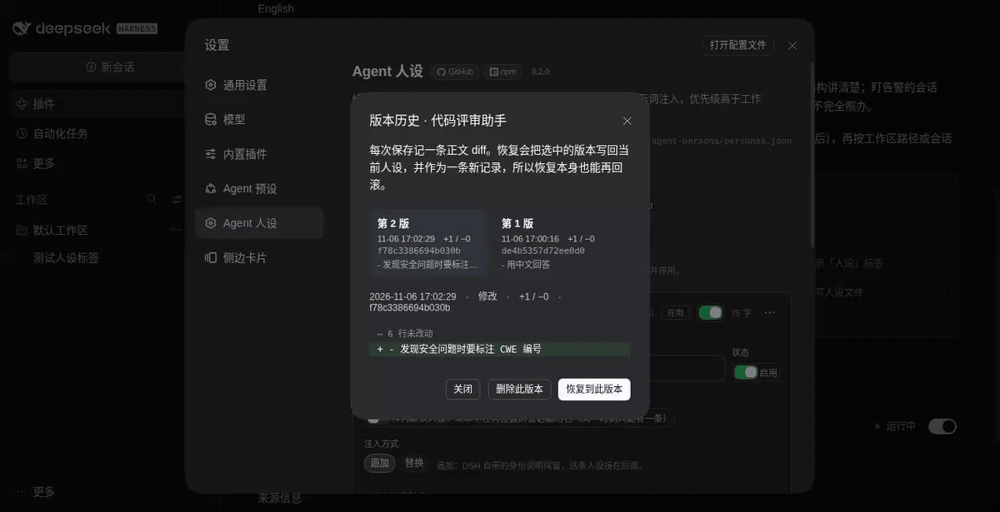
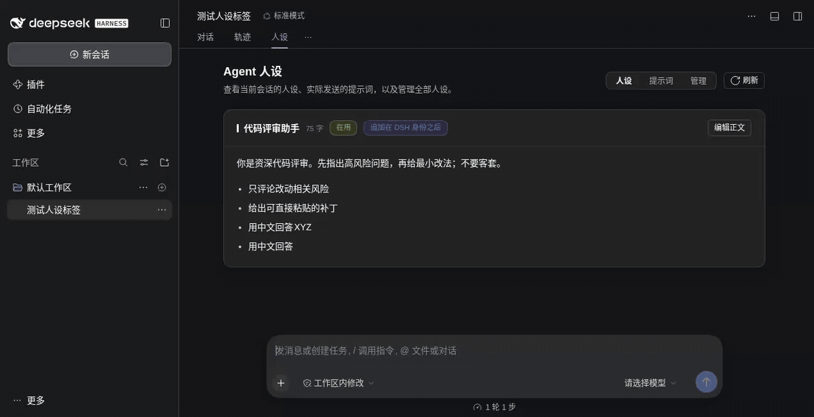
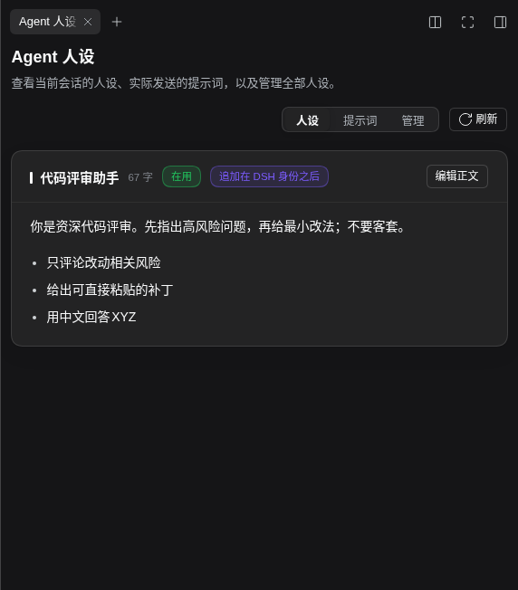

# dsh-agent-persona

Different system prompt personas for different **workspaces** and **sessions**.

[](https://www.npmjs.com/package/dsh-agent-persona)
[](./LICENSE)
[](https://github.com/Awoodwhale/dsh-agent-persona/actions/workflows/ci.yml)

[中文](./README.md)

## What it solves

One DSH install usually runs several kinds of work at once. While you're writing frontend code, you want the agent to give you the edit and skip the pleasantries. While you're writing docs, you want structure first. In a session where you're watching alerts, you want it to confirm before touching anything. Stuffing all of that into `AGENTS.md` doesn't work well — workspace instructions arrive as a user message, and the model is free to treat them as advice.

This plugin writes a persona as **a section of the system prompt** (section name `agent-persona`, right after DSH's built-in identity line) and dispatches it by workspace path or session id. One location belongs to at most one persona, and the more specific rule wins. After you save, the next message uses the new persona.

## Install

Requires DSH `0.2.0-rc.2` or newer; this release is tested on `0.2.2-rc.1` (full list below). Install it into the profile you use, either from a plugin market such as dshmarket or from the CLI:

```bash
dsh plugin --profile web add dsh-agent-persona
```

Then **restart `dsh web` once**. Profile bundles are read at startup, and the plugin registers itself from there.

After the restart the settings sidebar has an **Agent 人设** page, and `~/.dsh/dsh-agent-persona/state.json` contains a load heartbeat saying which file was loaded, where personas are stored, and how many there are.

Upgrade or remove with `dsh plugin --profile web update|remove dsh-agent-persona`, then restart again. Your persona file is not deleted or overwritten. There are also local install scripts: `bash scripts/install.sh` on Unix, `scripts/install.ps1` on Windows.

## Three-minute setup



Open **Settings → Agent 人设**, click **新建人设** (new persona), and add locations one row at a time under **适用范围** (scope): pick **workspace directory** or **a specific session**, then choose the target from the dropdown. The list comes from DSH's own workspaces and sessions, and sessions show their title and "a few minutes ago" — no session id to copy. For prefix, contains, or regex matching, choose **自己输入…** (type it yourself).

Write the body, turn the persona on, save. Two things worth knowing up front:

- New personas start **disabled**, so creating one never changes an existing session;
- A location can only belong to one persona. Assign a workspace to a new persona and the previous owner loses it; the save message tells you who it was taken from.

## Where it shows up

| Surface | Location | What it's for |
|---|---|---|
| **Settings page** | Settings → Agent 人设 | Create, edit, delete, duplicate, reorder personas; write the body, preview Markdown, let AI rewrite a draft. GitHub/npm links and the installed version sit next to the title |
| **Session tab** | **人设** tab at the top of a conversation | See which persona matched, the system prompt actually sent, and manage personas in place |
| **Sidebar card** | dsh-better-sidebar's right sidebar | Mounts the same 人设 page in the sidebar (requires that plugin) |
| **Plugin detail** | Web GUI → Plugins → dsh-agent-persona | Six preference switches, plugin icon, and display name |

### Plugin detail configuration



The plugin detail page has a new **界面与功能** (Interface and features) block. Its subtitle reads: decides where this plugin shows up in DSH and what protection the editor gets; persona content is still edited under Settings → Agent 人设, and once the settings entry is hidden this page is the way back. All six switches live here, and the same group stays on the settings page — both write the same `prefs`, so changing either side updates the other. Each switch saves as you flip it; there is no save button.

Turning off **在设置左栏显示「Agent 人设」** only hides the page from the settings navigation. The plugin detail page remains, so you can keep editing and turn the entry back on at any time. In the plugin list the display name is **Agent 人设** in Chinese and **Agent Persona** in English; the description comes from `locale/`, and the icon is `icon.svg` at the package root (it does not follow the theme color).



## Personas: list and editor

Personas are ordered top to bottom by priority. Each card shows its enabled state, fallback flag, the workspaces and sessions it applies to, body length, and rule count. The `⋯` menu has move up, move down, duplicate, and delete. A collapsed persona with **no locations at all** says "未设置位置：不生效，该会话仍用 DSH 自带的 prompt" — it's a draft, not a fallback. To use it as a fallback, turn on **默认人设** on the card; only one persona can be the fallback at a time.



Expanding a card lets you change the name, fallback flag, injection mode, and body. The body has a Markdown preview and can be rewritten by the model currently configured in DSH. The AI only produces a suggestion: it enters the editor only after you click **采用** or **追加**, and only a save writes it to disk. Import/export lives on the same page: export produces a JSON file (and copies it to the clipboard); import accepts a file or pasted text, previews each persona's word and rule counts as you type, and writes everything as "new and disabled", so it never replaces your fallback.

## Version history (opt-in)



With **保存人设版本历史** on, every body save appends a diff to `personas.history.json`. The **版本历史** button at the bottom of the editor opens the compare window:

- **Body only**: renaming, enabling, or changing scope does not create a version;
- **Diffs, not snapshots**: unchanged lines are stored as counts, only changed lines keep their text;
- **Restore and delete**: any version can be restored, and restores themselves are recorded, so a bad restore can be undone. Deleting a version recomputes later diffs against the new predecessor, so the chain stays intact;
- **Dedupe**: if the first 16 hex characters of the body's sha256 match the latest version, no new version is added — covers undo, re-save after restore, and re-importing the same body;
- Turning the switch off only stops recording; existing history stays readable and restorable.

## The 人设 tab in a session



Select a session and the top of the view has **人设 / 提示词 / 管理** (persona / prompt / manage):

- **人设**: which persona matched, which rules matched, the rendered body, and an inline editor;
- **提示词**: the system prompt **actually sent** for this session, with rendered/source toggle, copy, and refresh;
- **管理**: the same cards as the settings page, for creating, enabling, editing, reordering, duplicating, and deleting in place.

Next to it is a read-only conversation log: it shows only what you actually typed, and plugin-injected content that looks like a user message is collapsed into a one-line notice. Long messages can be expanded individually, and you can jump to the latest one.

## Sidebar card



With **dsh-better-sidebar** installed, the same 人设 page can be mounted in the right sidebar. If that plugin is absent, the **注册到 dsh-better-sidebar** switch is not shown, and everything else keeps working.

## The six switches

| Switch | Default | Effect | Where to change | When it applies |
|---|---|---|---|---|
| 在设置左栏显示「Agent 人设」 | On | Whether the page appears in the settings sidebar; when off, reach it via Plugins → dsh-agent-persona | Settings page or plugin detail | Immediately |
| 在对话页显示「人设」标签 | On | Whether the 人设 tab is registered on the conversation page | Settings page or plugin detail | Immediately (registered/unregistered at runtime) |
| 注册到 dsh-better-sidebar | On | Whether the 人设 page is registered in the right sidebar; hidden when that plugin is not installed | Settings page or plugin detail | Immediately |
| 编辑后自动保存 | Off | Auto-save the editor about one second after you stop typing | Settings page or plugin detail | Immediately; not while switching scope rows, to avoid saving a half-made selection |
| 保存人设版本历史 | Off | Record a restorable diff on every body save | Settings page or plugin detail | Immediately; turning it off stops new versions, old history stays viewable |
| 禁止模型改写人设文件 | On | Reject tool calls that would write to the persona store (reads and greps are unaffected) | Settings page or plugin detail | On the next tool call |

Preferences live in the `prefs` field of the persona file, not in the browser, so they share the data's visibility. The browser keeps a mirror only to decide whether to register a view at load time.

## Matching and priority

When the system prompt is assembled:

1. Disabled personas are skipped;
2. Any matching row makes a persona a candidate. Candidates are compared by specificity: session id (3 points) > workspace (1 point), and exact > prefix/contains/regex;
3. Ties go to the persona higher in the list;
4. A persona with no locations does not participate (draft state) unless it is marked as fallback;
5. If nothing matches, the fallback is used when set; otherwise nothing is injected;
6. If the winning persona's body is empty, that means "no persona here" and nothing is injected.

Of the four match types, only `完全一致` (exact) normalizes paths (`/a/project/` and `/a/project` are the same); prefix, contains, and regex compare your string as written. Empty values, invalid regexes, and missing session fields simply don't match — they don't raise errors. Details in [docs/architecture.md](./docs/architecture.md).

### Injection: append or replace

| Mode | Effect |
|---|---|
| **Append** (default) | Keep DSH's built-in identity line and append the persona after it |
| **Replace** | Drop DSH's built-in identity line and the deployment's own persona section; use only this persona |

**Replace** only touches the section the deployment writes. If an agent preset defines a persona in its own scope, the plugin does not override it — that identity prompt wins.

The body supports `{{model}}` and `{{cwd}}`, substituted with current values at render time. Other `{{...}}` placeholders are removed rather than failing the whole assembly.

## Data and security

```
~/.dsh/dsh-agent-persona/
├── personas.json          # personas + preferences, mode 600, atomic writes
├── personas.history.json  # version history (created when the switch is on)
└── state.json             # load heartbeat, rewritten on every load
```

By default there is **one global store**, shared by every profile on the machine. To give a profile its own store, override `storePath` in its `cordis.patch.yml`:

```yaml
- id: agent-persona
  config:
    storePath: /Users/you/.dsh/profiles/<profile>/personas.json
```

The active path is always shown in the meta line of the Agent 人设 page (`保存在 …`). Other options are `tuneProvider` / `tuneModel`; leave them empty to use the model configured in DSH.

One honest caveat: **a persona is a behavioral instruction, not a security boundary**. It shapes how the model talks; it does not stop it from using tools. The plugin registers a global `tools.guard` that uses capabilities to decide whether a call could write `personas.json`, its history, or a backup copy — paths in arguments, shell redirect targets and write-like commands, and targets inside patch bodies all count. On a local `danger-full-access` setup it can still be bypassed: modified plugin code, runtime-assembled paths, `$VAR` expansion, and alias wrappers are invisible to static checks. For something stronger, work at the machine level — e.g. `chflags uchg <persona file>` — or run DSH in a restricted sandbox.

If the file exists but cannot be read, the page says why, and backs the original up as `personas.json.bak-<timestamp>` before the first save. If the backup fails, nothing is written.

## Compatibility

The current `dsh.compatibility` in `package.json` declares these versions, and `engines.dsh` pins the same range `>=0.2.0-rc.2 <0.3.0`:

| DSH version | Notes |
|---|---|
| `0.2.0-rc.2` | Earliest supported version |
| `0.2.1-rc.2` | Tested |
| `0.2.2-rc.1` | Tested; current release target |

The table means "we ran it on these versions", not a compatibility promise for older or newer ones.

## Straight talk

- **Only the first match wins**; personas are not concatenated. Matching is a linear scan — fine for dozens of rules, but hundreds need a redesign.
- Install it once per profile. Two rows with the same id in one process prevent the composition from starting.
- Workspace paths in rules are compared as strings. Don't rely on case or symlink equivalence (`完全一致` normalizes paths; the other three do not).
- The test suite covers unit tests and source audits; UI behavior is verified in a real browser.
- Persona files are plaintext. Don't put secrets in the body.

## Development

The source is TypeScript; `lib/` is build output (not committed). `src/index.ts` is the host half (storage, matching, the system-prompt section, remote services), `src/client.ts` is the client half (settings page, session view, sidebar card), and `src/endpoints.ts` is the single source for remote methods. Layout details are in [docs/architecture.md](./docs/architecture.md).

```bash
npm install
npm run build        # generate:remote → tsc → esbuild (writes lib/)
npm run typecheck    # two tsconfigs
npm test             # unit tests + source audits + generated-artifact drift check
```

How to see code changes live and how to wire up development are in [docs/development.md](./docs/development.md).

## License

Apache-2.0, see [LICENSE](./LICENSE).
